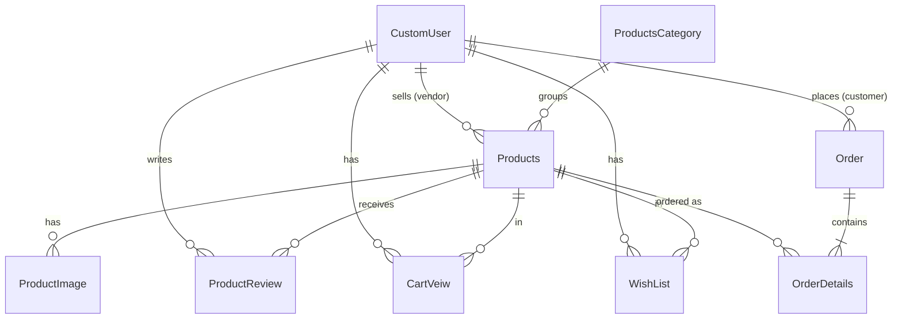

# Baggie API

A REST backend for **Baggie**, a multi-vendor e-commerce marketplace. Vendors register and list products; customers browse, add items to a cart or wishlist, place orders, and leave reviews.

Built with **Django** and **Django REST Framework**, using JWT authentication, Google sign-in, and auto-generated Swagger documentation.


---

## Table of Contents

- [Features](#features)
- [Tech Stack](#tech-stack)
- [Project Structure](#project-structure)
- [Data Model](#data-model)
- [Getting Started](#getting-started)
- [Environment Variables](#environment-variables)
- [API Documentation](#api-documentation)
- [Authentication](#authentication)
- [API Reference](#api-reference)
- [Filtering, Search and Pagination](#filtering-search-and-pagination)
- [Deployment](#deployment)
- [Known Limitations and Roadmap](#known-limitations-and-roadmap)
- [License](#license)

---

## Features

- **Two user roles** – vendors (email login) and customers (phone-number login), plus a superuser role for admins
- **JWT authentication** – access and refresh tokens via `djangorestframework-simplejwt`
- **Google social login** – verifies a Google ID token and signs the user in
- **Email verification and password reset** – token-based flows sent over SMTP
- **Product catalog** – categories, products, pricing and discounts, stock status, and approval status
- **Product images** – a cover image plus a gallery; images are resized automatically on upload (400×400 cover, 600×600 gallery)
- **Orders** – an order with nested line items created in a single request
- **Cart, wishlist and reviews** – per-customer cart items, saved products, and star ratings with comments
- **Filtering, search, ordering and pagination** on list endpoints
- **Interactive Swagger UI** generated with `drf-yasg`

---

## Tech Stack

| Layer | Technology |
|---|---|
| Language | Python 3.7 |
| Framework | Django 3.x, Django REST Framework |
| Auth | Simple JWT, django-allauth, Google OAuth2 (`google-auth`) |
| API docs | drf-yasg (Swagger / OpenAPI 2.0) |
| Database | SQLite (development); PostgreSQL-ready |
| Images | Pillow, django-imagekit |
| Nested writes | drf-writable-nested |
| Server | Gunicorn (Heroku `Procfile` included) |

---

## Project Structure

```
BackendBaggie/
├── Baggie/              # Project settings, root URL config, WSGI/ASGI
├── users/               # Custom user model, registration, login, JWT, Google auth, password reset
├── productsCategory/    # Product categories
├── products/            # Products (with nested images and reviews)
├── productsImage/       # Product gallery images
├── orders/              # Orders (with nested order line items)
├── orderDetails/        # Order line items
├── cartview/            # Shopping cart
├── wishlist/            # Customer wishlists
├── reviewproduct/       # Product reviews and star ratings
├── poll/                # Experimental app (routes disabled)
├── media/               # Uploaded images (profiles, product covers, product gallery)
├── manage.py
├── Pipfile
└── Procfile
```

---

## Data Model



| Model | Key fields |
|---|---|
| `CustomUser` | `email` (login), `mobileNumber`, `name`, `vandorName`, `profileImage`, `role` (`vendor` / `customer` / `superuser`), `is_verified`, `auth_provider` |
| `ProductsCategory` | `categoryName` |
| `Products` | `productname`, `productpriceoriginal`, `sellproductprice`, `percentageofsell`, `productweight`, `productinstock`, `productcoverImage`, `productDetails`, `productdiscount`, `productapprovalstatus`, `isrecentproduct` (`is_new` / `not_new`), `vendorID`, `productcategoryID` |
| `ProductImage` | `productID`, `image`, `imageName` |
| `Order` | `customerID`, `addressOne`, `addressTwo`, `city`, `phonenumber`, `additionalnumber`, `orderemail`, `orderDate`, `orderShipped` |
| `OrderDetails` | `order`, `productID`, `orderDetailsName`, `orderprice`, `orderQuantity`, `toalprice` |
| `CartVeiw` | `productID`, `customerID`, `cartstatus`, `review_at` |
| `WishList` | `productID`, `customerID`, `wishtatus`, `wish_at` |
| `ProductReview` | `productID`, `customerID`, `review`, `starreview`, `review_at` |

> Field names match the code exactly (including spellings such as `vandorName`, `toalprice` and `CartVeiw`), since API clients must send them as written.

---

## Getting Started

### Prerequisites

- Python 3.7
- pip (or pipenv)
- PostgreSQL client libraries (required by `psycopg2`, because the user model imports `django.contrib.postgres`)

### 1. Clone the repository

```bash
git clone https://github.com/abdullah1107/Baggiesapi-Update.git
cd Baggiesapi-Update/BackendBaggie
```

### 2. Create a virtual environment

```bash
python3.7 -m venv venv
source venv/bin/activate        # Windows: venv\Scripts\activate
```

### 3. Install dependencies

The `Pipfile` lists only the deployment packages, so install the full set below. Saving it as `requirements.txt` is recommended.

```text
Django>=3.1,<3.2
djangorestframework
djangorestframework-simplejwt
drf-yasg
django-filter
django-cors-headers
django-allauth
django-oauth-toolkit
social-auth-app-django
django-rest-framework-social-oauth2
django-imagekit
drf-writable-nested
drf-tweaks
google-auth
requests
requests-oauthlib
PyJWT
Pillow<10
psycopg2-binary
gunicorn
django-heroku
```

```bash
pip install -r requirements.txt
```

> `Pillow<10` is required because the image-resize code uses `Image.ANTIALIAS`, which was removed in Pillow 10.

### 4. Configure environment variables

```bash
cp .env_sample .env
# Edit .env with your own values (see the next section), then:
source .env
```

### 5. Run migrations and create an admin

```bash
python manage.py migrate
python manage.py createsuperuser
```

### 6. Start the development server

```bash
python manage.py runserver
```

Open **http://127.0.0.1:8000/** for the Swagger UI and **http://127.0.0.1:8000/admin/** for the Django admin.

---

## Environment Variables

| Variable | Description | Example |
|---|---|---|
| `SECRET_KEY` | Django secret key | `change-me` |
| `DEBUG` | Debug mode | `False` in production |
| `DB_NAME` / `DB_USER` / `DB_PASSWORD` / `DB_HOST` / `DB_PORT` | PostgreSQL connection | `BaggiesDB`, `127.0.0.1`, `5432` |
| `DOMAIN` | Base URL used in email links | `http://127.0.0.1:8000` |
| `APP_SCHEME` | Mobile deep-link scheme allowed for redirects | `baggie` |
| `CORS_WHITELIST` | Comma-separated allowed origins | `http://localhost:3000` |
| `EMAIL_HOST` / `EMAIL_PORT` / `EMAIL_USE_TLS` | SMTP server | `smtp.gmail.com`, `587`, `True` |
| `EMAIL_HOST_USER` / `EMAIL_HOST_PASSWORD` | SMTP credentials (use an app password) | — |
| `DEFAULT_FROM_EMAIL` | Sender address | `noreply@example.com` |
| `SENDGRID_API_KEY` | Optional SendGrid key | — |
| `GOOGLE_CLIENT_ID` | OAuth client ID for Google sign-in | `xxxx.apps.googleusercontent.com` |

> Never commit real credentials. Keep `.env` in `.gitignore`.

---

## API Documentation

| URL | Description |
|---|---|
| `/` | Swagger UI (interactive) |
| `/api/api.json/` | Raw OpenAPI schema (JSON) |
| `/admin/` | Django admin |

To call protected endpoints from Swagger, click **Authorize** and enter `Bearer <access_token>`.

---

## Authentication

The API uses JWT bearer tokens.

| Token | Lifetime |
|---|---|
| Access | 24 hours |
| Refresh | 30 days |

Send the access token on each request:

```http
Authorization: Bearer <access_token>
```

### Example: register a customer

```bash
curl -X POST http://127.0.0.1:8000/auth/register/customer/ \
  -H "Content-Type: application/json" \
  -d '{
        "name": "Jane Doe",
        "email": "jane@example.com",
        "mobileNumber": "0123456789",
        "password": "StrongPass123"
      }'
```

Response (`201 Created`):

```json
{
  "response": { "id": 1, "name": "Jane Doe", "email": "jane@example.com", "mobileNumber": "0123456789" },
  "refresh": "<refresh_token>",
  "access": "<access_token>"
}
```

### Example: customer login with phone number

```bash
curl -X POST http://127.0.0.1:8000/auth/loginwithphone/customer/ \
  -H "Content-Type: application/json" \
  -d '{ "mobileNumber": "0123456789", "password": "StrongPass123" }'
```

### Example: refresh an access token

```bash
curl -X POST http://127.0.0.1:8000/auth/token/refresh/ \
  -H "Content-Type: application/json" \
  -d '{ "refresh": "<refresh_token>" }'
```

---

## API Reference

All paths are relative to the server root, for example `http://127.0.0.1:8000`.

### Auth and Users — `/auth/`

| Method | Endpoint | Description | Body |
|---|---|---|---|
| POST | `/auth/register/vendor/` | Register a vendor (multipart, includes logo) | `email`, `password`, `mobileNumber`, `vandorName`, `profileImage` |
| POST | `/auth/register/customer/` | Register a customer | `name`, `email`, `mobileNumber`, `password` |
| POST | `/auth/login/vendor/` | Vendor login with email | `email`, `password` |
| POST | `/auth/loginwithphone/customer/` | Customer login with phone | `mobileNumber`, `password` |
| POST | `/auth/token/refresh/` | Get a new access token | `refresh` |
| POST | `/auth/social/google/` | Sign in with a Google ID token | `auth_token` |
| GET | `/auth/email-verify/?token=<token>` | Verify an email address | — |
| POST | `/auth/request-passwordchange-email/` | Send a password-reset email | `email` |
| GET | `/auth/password-reset/<uidb64>/<token>/` | Validate a reset link | — |
| PATCH | `/auth/password-reset-complete` | Set a new password | `password`, `token`, `uidb64` |
| POST | `/auth/logout/` | Log out (requires auth) | `refresh` |
| GET | `/auth/vendorlist/?role=vendor` | List users, filterable by role | — |

### Product Categories — `/productCategory/`

| Method | Endpoint | Description |
|---|---|---|
| GET | `/productCategory/api/v1/alllist` | All categories with nested products (home page) |
| GET | `/productCategory/api/v1/` | List categories |
| POST | `/productCategory/api/v1/` | Create a category |
| GET / PUT / PATCH / DELETE | `/productCategory/api/v1/<id>` | Retrieve, update or delete a category |

### Products — `/products/`

| Method | Endpoint | Description |
|---|---|---|
| GET | `/products/api/v1/list` | List products with nested images and reviews, newest first |
| POST | `/products/api/v1/create/` | Create a product with nested gallery images |
| POST | `/products/api/v1/onlyproduct/create` | Create a product without gallery images |
| GET / PUT / PATCH / DELETE | `/products/api/v1/<id>` | Retrieve, update or delete a product |

### Product Images — `/productImage/`

| Method | Endpoint | Description |
|---|---|---|
| GET / POST | `/productImage/api/v1/` | List or upload product images |
| GET / PUT / PATCH / DELETE | `/productImage/api/v1/<id>` | Retrieve, update or delete an image |

### Orders — `/orders/`

| Method | Endpoint | Description |
|---|---|---|
| GET | `/orders/api/v1/list` | List orders |
| POST | `/orders/api/v1/create` | Create an order with line items |
| GET | `/orders/api/v1/details/<id>` | Get one order |
| PUT / PATCH | `/orders/api/v1/update/<id>` | Update an order (for example, mark as shipped) |
| DELETE | `/orders/api/v1/delete/<id>` | Delete an order |

**Create an order with line items in one request:**

```json
POST /orders/api/v1/create
{
  "customerID": 1,
  "addressOne": "House 12, Road 5",
  "addressTwo": "Apt 3B",
  "city": "Dhaka",
  "phonenumber": "0123456789",
  "orderemail": "jane@example.com",
  "choices": [
    { "productID": 7, "orderDetailsName": "Leather Tote", "orderprice": "1500.000", "orderQuantity": "2", "toalprice": "3000.000" },
    { "productID": 9, "orderDetailsName": "Canvas Bag",   "orderprice": "800.000",  "orderQuantity": "1", "toalprice": "800.000" }
  ]
}
```

### Order Details — `/orderdetails/`

| Method | Endpoint | Description |
|---|---|---|
| GET / POST | `/orderdetails/` | List or create order line items |
| GET / PUT / PATCH / DELETE | `/orderdetails/<id>` | Retrieve, update or delete a line item |

### Cart — `/cartview/`

| Method | Endpoint | Description |
|---|---|---|
| GET | `/cartview/api/v1/list` | List cart items with customer info |
| POST | `/cartview/api/v1/create` | Add a product to a cart (`productID`, `customerID`) |
| GET | `/cartview/api/v1/details/<id>` | Get one cart item |
| PUT / PATCH | `/cartview/api/v1/update/<id>` | Update a cart item |
| DELETE | `/cartview/api/v1/delete/<id>` | Remove a cart item |

### Wishlist — `/wishlist/`

| Method | Endpoint | Description |
|---|---|---|
| GET | `/wishlist/api/v1/list` | List wishlist items with customer info |
| POST | `/wishlist/api/v1/create` | Add a product to a wishlist (`productID`, `customerID`) |
| GET | `/wishlist/api/v1/details/<id>` | Get one wishlist item |
| PUT / PATCH | `/wishlist/api/v1/update/<id>` | Update a wishlist item |
| DELETE | `/wishlist/api/v1/delete/<id>` | Remove a wishlist item |

### Reviews — `/reviewproduct/`

| Method | Endpoint | Description |
|---|---|---|
| GET | `/reviewproduct/api/v1/list` | List reviews |
| POST | `/reviewproduct/api/v1/create` | Add a review (`productID`, `customerID`, `review`, `starreview`) |
| GET | `/reviewproduct/api/v1/details/<id>` | Get one review |
| PUT / PATCH | `/reviewproduct/api/v1/update/<id>` | Update a review |
| DELETE | `/reviewproduct/api/v1/delete/<id>` | Delete a review |

---

## Filtering, Search and Pagination

List endpoints use **limit/offset pagination** with a default page size of 30:

```
GET /products/api/v1/list?limit=10&offset=20
```

Paginated responses have this shape:

```json
{ "count": 120, "next": "...?limit=10&offset=30", "previous": "...?limit=10&offset=10", "results": [ ... ] }
```

| Endpoint | Filter / search fields |
|---|---|
| Products | `productname`, `productpriceoriginal`, `productUpdate`, `vendorID__vandorName`, `productcategoryID__categoryName` |
| Categories | `categoryName` |
| Orders | `city`, `phonenumber`, `additionalnumber`, `orderemail`, `orderDate` |
| Reviews | `productID`, `review_at`, `starreview` |
| Users | `role` |

Examples:

```
GET /products/api/v1/list?productcategoryID__categoryName=Handbags
GET /products/api/v1/list?search=leather
GET /products/api/v1/list?ordering=-productpriceoriginal
GET /reviewproduct/api/v1/list?productID=7
```

Datetimes are returned as `YYYY-MM-DD HH:MM:SS` (UTC). Validation errors that are not tied to a single field are returned under the `errors` key.

---

## Deployment

A `Procfile` is included for Heroku:

```
release: python manage.py migrate --no-input
web: gunicorn Baggie.wsgi
```

Before deploying:

1. Set `DEBUG = False` and restrict `ALLOWED_HOSTS`.
2. Load `SECRET_KEY`, database, and email settings from environment variables.
3. Switch `DATABASES` to PostgreSQL (Heroku's filesystem is ephemeral, so SQLite data is lost on restart).
4. Store uploaded media on S3 or a similar service for the same reason.
5. Run `python manage.py collectstatic`.

---

## Known Limitations and Roadmap

- **Permissions are currently open.** The role-based permission classes (`CanEditPermissionForProducts`, `CanCreatePermissionforCustomer`, `CanUpdateDeletePermissionforVendor`, and others) exist but are commented out in the views, and the default permission is `AllowAny`. Only `/auth/logout/` requires authentication. Enable these before production use.
- **Secrets in settings.** Settings and the sample env file should hold no real credentials; load everything from environment variables.
- **CORS middleware not registered.** `corsheaders` is installed but `CorsMiddleware` is not in `MIDDLEWARE`, so browser clients on other origins will be blocked.
- **No `requirements.txt`.** Add the dependency list above to the repository.
- **Tests.** The `tests.py` files are empty; add API tests for auth, products, and orders.
- **Database file in Git.** `baggie.db` and uploaded media are committed; add them to `.gitignore`.

---

## License

See [LICENSE](MIT License)

## Author

[@abdullah1107](https://github.com/abdullah1107)
